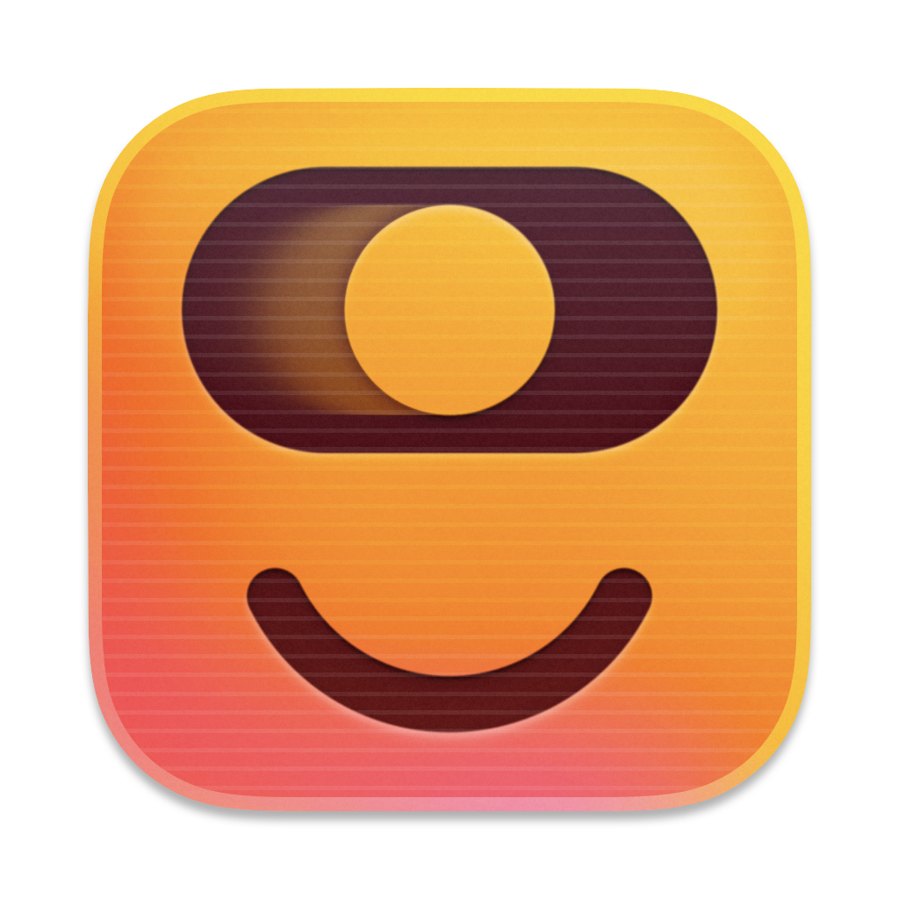
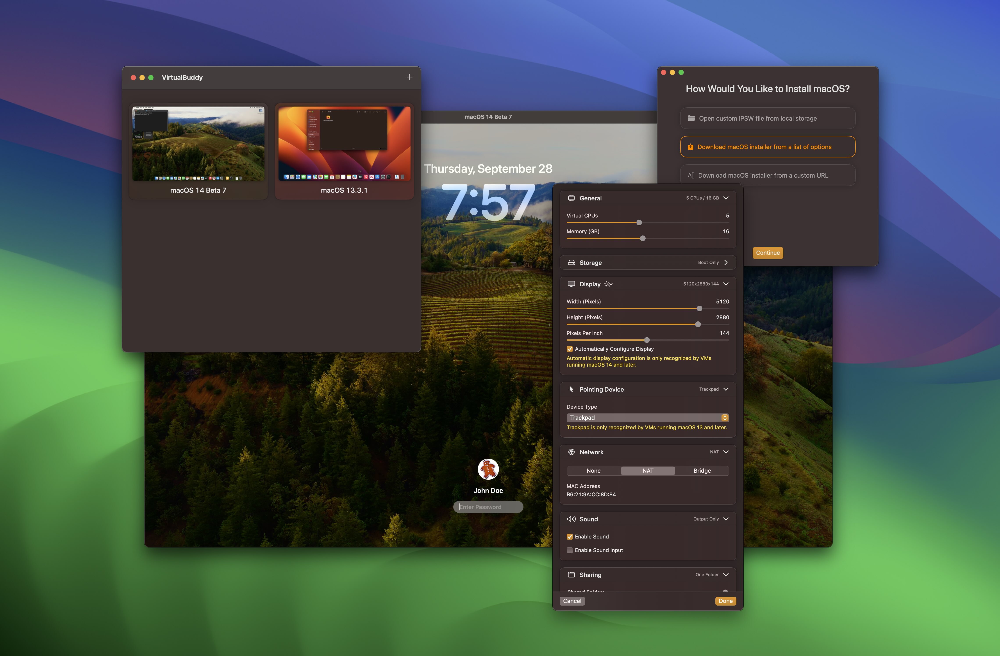
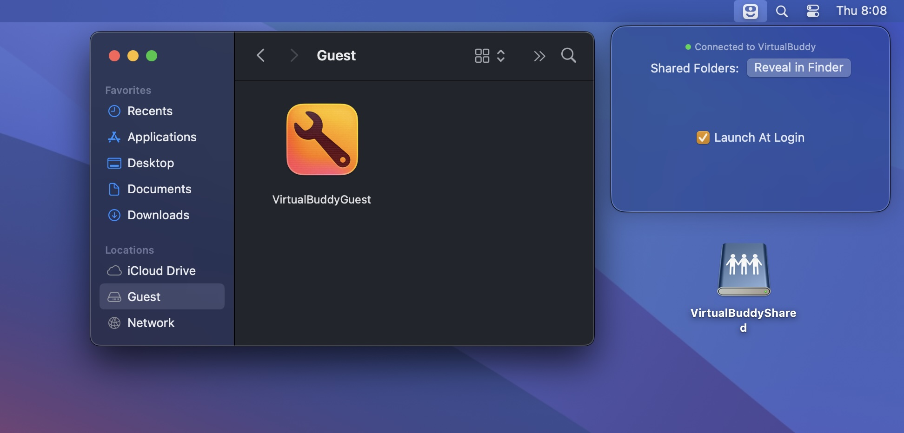

# VirtualBuddy

VirtualBuddy runs macOS and Linux virtual machines on Macs with Apple silicon. Use it to test your apps on multiple versions of macOS, including betas.



## System Requirements

- **VirtualBuddy requires a Mac with Apple silicon running macOS 14 Sonoma or later.**
- Guest systems include macOS 12 Monterey or later and ARM64 Linux distributions such as Ubuntu Desktop and Ubuntu Server. The installation wizard shows which catalog images and features your Mac supports.

## Download

Download the [latest stable release](https://github.com/insidegui/VirtualBuddy/releases/latest) or browse [all releases, including betas](https://github.com/insidegui/VirtualBuddy/releases).

If you use Homebrew, run `brew install --cask virtualbuddy`.

VirtualBuddy is free and open-source. If you’d like to support its development, [you may purchase it on Gumroad](https://insidegui.gumroad.com/l/virtualbuddy) or [sponsor my work on GitHub](https://github.com/sponsors/insidegui).

## Installing macOS or Linux

Click **+** in the VirtualBuddy library and choose macOS or Linux. Select a version from the catalog to download its installer, enter a custom download URL, or open a file you already have. Use an IPSW restore image for macOS or an ARM64 ISO for Linux.

Some macOS restore images require newer device support on the host. Select the version in the catalog to see its requirements and installation instructions. Apple provides device support with compatible versions of Xcode and sometimes as a separate [Apple Developer download](https://developer.apple.com/download/).

**Installing macOS 27 Golden Gate from an IPSW** requires a host running macOS 26 or later with compatible device support. To upgrade an existing macOS VM, open **System Settings → General → Software Update** inside the guest. For beta releases, see [how to enable beta updates in a VM](https://github.com/insidegui/VirtualBuddy/discussions/194).

## Features

- Configure CPU cores, memory, storage, displays, and networking for each VM.
- Boot macOS into Recovery to change startup security settings.
- Forward loopback TCP ports and Unix sockets between your Mac and a macOS guest with [Service Tunnels](./Documentation/ServiceTunnels.md).
- Control the app and your virtual machines from Terminal and scripts with the [`vbctl` command-line tool](./Documentation/CommandLine.md).
- Share folders with macOS 13 or later guests and share the clipboard with macOS 14 or later guests running the current VirtualBuddyGuest app.
- Save and resume supported macOS 14 or later VMs, or duplicate a VM to keep a copy for testing.
- When both the host and the guest run macOS 27 or later, you can pass USB devices through to the VM and create the first user account automatically to skip Setup Assistant.

## Tips and Tricks

### VirtualBuddyGuest app

VirtualBuddy automatically mounts a disk image when you boot a supported macOS VM with the guest app enabled. In the VM, open the **Guest** disk in Finder’s sidebar and double-click **VirtualBuddyGuest** to install it.

The current guest app requires macOS 14 or later and supports clipboard sharing and automatic mounting of shared folders. On macOS 13, the legacy guest app only mounts shared folders automatically. macOS 12 guests run without VirtualBuddyGuest.



### Run a macOS app from Xcode

Development builds from `main` include experimental support for running and debugging your Mac app in a VM directly from Xcode. [Set up Xcode debugging](./README-Developers.md)

### Duplicate a virtual machine

Shut down the VM or save and close it, then right-click it in the VirtualBuddy library and choose **Duplicate**. If the VM has a saved session, the copy can resume from the same point. On APFS the two copies initially share disk space, so you can keep a clean VM and use the duplicate for testing.

### Share folders with a macOS guest

For a guest running macOS 13 or later, add folders under **Sharing** in the VM’s settings. VirtualBuddyGuest can mount them automatically. To mount them manually, run this command in the guest’s Terminal.

```bash
mkdir -p ~/Desktop/VirtualBuddyShared && mount -t virtiofs VirtualBuddyShared ~/Desktop/VirtualBuddyShared
```

For older guests, use macOS File Sharing over the VM’s network connection.

## Building from source

1. Open `VirtualBuddy.xcodeproj` in Xcode 27 with the macOS 27 SDK.
2. In [Signing.xcconfig](./VirtualBuddy/Config/Signing.xcconfig), set `VB_BUNDLE_ID_PREFIX` to a unique prefix such as `com.yourname.` (including the trailing period).
3. In **Signing & Capabilities**, select your development team for the app and its embedded targets, including `VirtualBuddyGuest`, `VirtualBuddyGuestHelper`, and `VirtualInstallationService`. Set `VB_DEVELOPMENT_TEAM` in [Security.xcconfig](./VirtualBuddy/Config/Security.xcconfig) to the same team ID for the installation service’s signing checks.
4. Choose the **VirtualBuddy** scheme and build and run it on **My Mac**.
